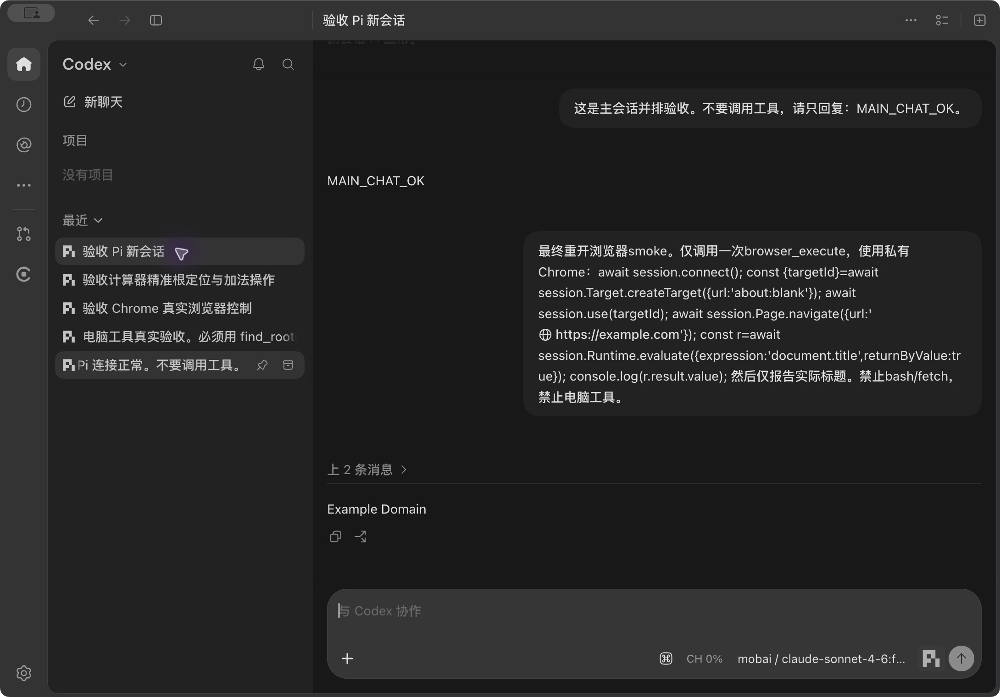
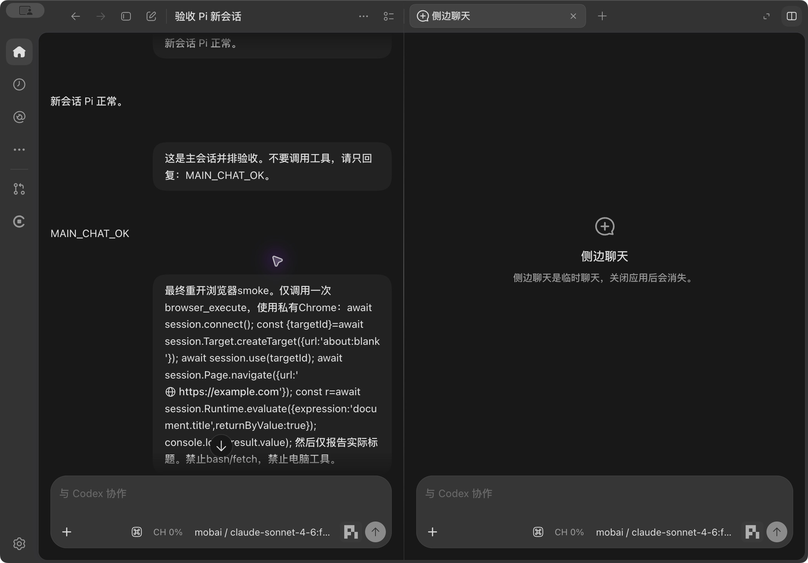
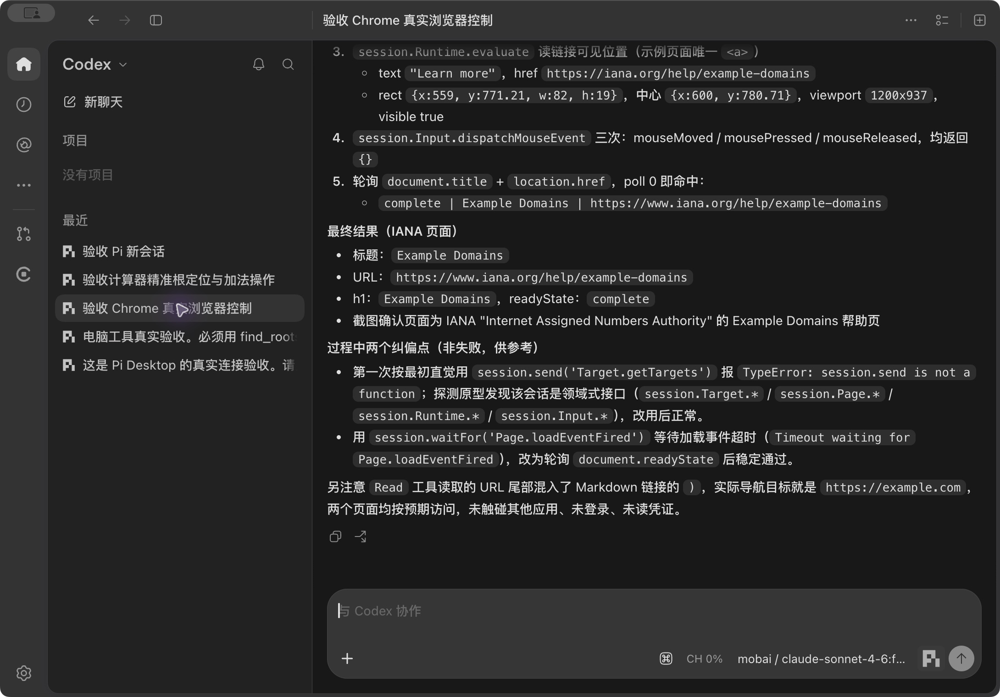

<div align="center">


# Pi Desktop

**给本机 Pi 的独立 macOS 桌面应用。打开即可使用，不需要 OpenAI 登录。**

Pi-only · 侧边聊天 · 电脑控制 · 浏览器控制

</div>

Pi Desktop 基于 [CodexHost](https://github.com/BytePioneer-AI/codex-host)，把本机 [Pi](https://pi.dev/) 接入独立桌面窗口。默认只使用 Pi；保留你在 Pi 中配置的模型、凭证和扩展。

当前为个人实验版本。已在 Apple Silicon Mac 上实际验收。

**[下载 macOS Apple Silicon DMG](https://github.com/WesternFastShooters/pi-desktop/releases/latest)**

## 可以做什么

| 功能 | 效果 |
| --- | --- |
| 本机 Pi 聊天 | 使用本机已安装的 Pi 和 `~/.pi/agent`，在桌面窗口中选择模型、聊天、查看工具结果。 |
| 无 OpenAI 登录门槛 | 打开应用即可进入。调用模型仍需要你自己的 Pi 模型配置。 |
| Pi-only | 代理选择与 `#` 菜单只列 Pi，不提供 Codex 生成入口。 |
| 侧边聊天 | 从主聊天打开并排会话，继承主聊天历史，再独立追问。 |
| 电脑控制 | Pi 使用 `find_roots`、`observe_ui`、`act_ui` 等工具查找、观察和操作 macOS 应用。 |
| 浏览器控制 | Pi 使用 `browser_execute` 在独立 Chrome 窗口中打开网页、读取内容和点击。 |
| 独立安装 | 使用自己的应用身份、数据目录和 Pi 图标，不覆盖原 ChatGPT 应用。 |

## 看看效果

下面均为本项目实际运行截图，不是设计稿。外壳中的部分旧品牌文字仍可能显示。

### Pi 桌面聊天



### 侧边聊天

截图展示新建侧边聊天布局；上下文继承与回复已另行实际验收。



### Pi 控制工具



已验证的例子：Pi 操作计算器输入 `2 + 3`，工具读回 `5`；Pi 在 Chrome 点击 Example Domain 的链接，读回 IANA 页面标题和地址。

## 使用前准备

- Apple Silicon Mac。Intel 构建路径存在，但本项目尚未在 Intel 上验收。
- 已配置可用模型的本机 Pi。也可以使用构建时包含的 Pi 后备运行环境。
- 浏览器控制需要安装 Google Chrome。
- 电脑控制需要 macOS 辅助功能和屏幕录制授权。普通聊天不依赖这两项权限。

**没有 OpenAI 登录要求，不等于无需模型凭证。** 模型请求使用你在 Pi 中配置的提供商和凭证；本仓库不提供 API key。

## 下载安装

1. 打开 [Releases](https://github.com/WesternFastShooters/pi-desktop/releases/latest)，下载 `Pi-Desktop-macos-arm64.dmg`。
2. 打开 DMG，将 `Pi Desktop.app` 拖入 `Applications`。
3. 从应用程序目录打开 Pi Desktop，选择本机 Pi 中已配置的模型。

当前提供 Apple Silicon 版。安装包使用 ad-hoc 签名，尚未 Apple 公证。若 macOS 阻止打开，可在系统设置 → 隐私与安全性中查看该应用的提示并选择仍要打开；不同 macOS 版本的提示可能不同。不建议关闭系统安全保护。参见 [Apple 打开应用说明](https://support.apple.com/102445)。

Release 同时提供 `SHA256SUMS.txt` 用于校验。预构建应用包含第三方桌面外壳；该外壳仍受其原有许可条款约束，仓库 LGPL 许可证不覆盖第三方外壳。

## 从源码构建

请自行准备合法取得的官方桌面应用副本；不要把原 `/Applications/ChatGPT.app` 当作待修改目标。

已验收的外壳版本为 `26.1007.21159` / build `20052`。其他版本需重新验证兼容性。

需要 Git、Node.js 24/npm、Python 3、Rust 与 Xcode Command Line Tools。

```bash
git clone https://github.com/WesternFastShooters/pi-desktop.git
cd pi-desktop

# 准备锁定版本的 Pi 运行环境；不安装进全局 ~/.pi/agent。
mkdir -p work/pi-runtime/bin
cp pi-desktop-packaging/pi-runtime/package*.json work/pi-runtime/
npm ci --ignore-scripts --prefix work/pi-runtime
ln -s ../node_modules/.bin/pi work/pi-runtime/bin/pi

# 输入独立官方应用副本；输出目录必须尚不存在。
bash pi-desktop-packaging/build.sh "/path/to/official-copy.app"   "$PWD/work/pi-runtime" "$PWD/work/pi-build"
```

构建脚本拉取固定 CodexHost 提交，应用随仓库交付的补丁，执行隔离测试，再生成 `Pi Desktop.app` 和 `Pi Desktop.dmg`。

构建后，将 `Pi Desktop.app` 拖入 `/Applications`，再打开应用。本机 Pi 优先；缺少本机 Pi 时使用包内后备。当前签名为 ad-hoc，尚未做 Apple 公证；干净系统首次安装仍需验证。

详细构建说明见 [打包说明](pi-desktop-packaging/README.txt)。

## 配置和数据

```text
本机 Pi → ~/.pi/agent
Pi Desktop 独立运行数据 → ~/Library/Application Support/Pi Desktop/
```

Pi 配置、凭证、扩展和会话与本机 Pi 共用。聊天会产生新的 Pi 会话数据；应用不会替你重写原模型配置和凭证。

桌面外壳、Host 与 Electron 的数据分别隔离。原 ChatGPT 应用不需要退出或修改。

浏览器使用每个 Pi 会话独立的 Chrome profile，不使用内嵌浏览器，也不接管已有 Chrome 会话。电脑工具优先复用本机已经配置的 `pi-computer-use`；缺少时使用包内后备，避免同名工具重复注册。

## 验证范围

- 实际通过：无登录进入、Pi 模型回复、历史恢复、Pi-only 菜单、侧边上下文继承与回复。
- 实际通过：计算器 `2+3=5`、浏览器真实点击跳转、退出重开。
- 通过：安装包校验、深度严格签名、安装到 `/Applications` 后的文件一致性。
- 通过：6 项打包测试、4 项 Rust 隔离测试、38 项 Renderer/Host 聚焦测试、124 项 Pi/上下文串行测试。
- 未覆盖：Intel Mac、干净系统首次授权与安装、Apple 公证、所有后续官方外壳版本。
- Pi 图标资源和应用配置通过检查；本机 Dock 像素截图接口受限，未将静态资源检查当作 Dock 视觉验收。

这些是本机验收结果，不代表 GitHub Actions 已执行 Pi Desktop 的完整构建。仓库保留的上游工作流不是本项目的发布流水线，本仓库暂时关闭 Actions。

## 来源与许可证

- [CodexHost](https://github.com/BytePioneer-AI/codex-host)：LGPL-3.0-only；基于 `08c7d65dddb03a79d5b311d47a0381c299316a3b`，完整源码及 [LICENSE](LICENSE) 保留。
- [Pi](https://github.com/badlogic/pi-mono)、[pi-computer-use](https://github.com/injaneity/pi-computer-use)、[pi-chrome-use](https://github.com/citrolabs/pi-chrome-use)：依赖版本锁定，原许可证随安装依赖保留。
- 本项目修改、打包代码和 Pi 图标按仓库 LGPL-3.0-only 提供。第三方桌面外壳不属于本仓库源码许可证。

Pi Desktop 是独立社区实验，不是 OpenAI 官方产品。

[上游项目文档](https://github.com/BytePioneer-AI/codex-host#readme) · [实现说明](docs/platforms/macos/pi-desktop.md)
